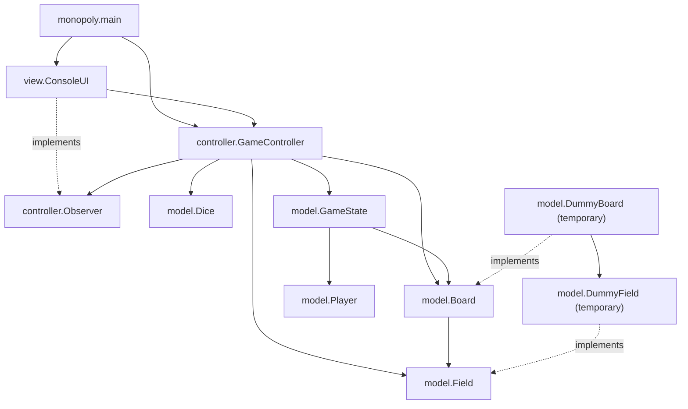
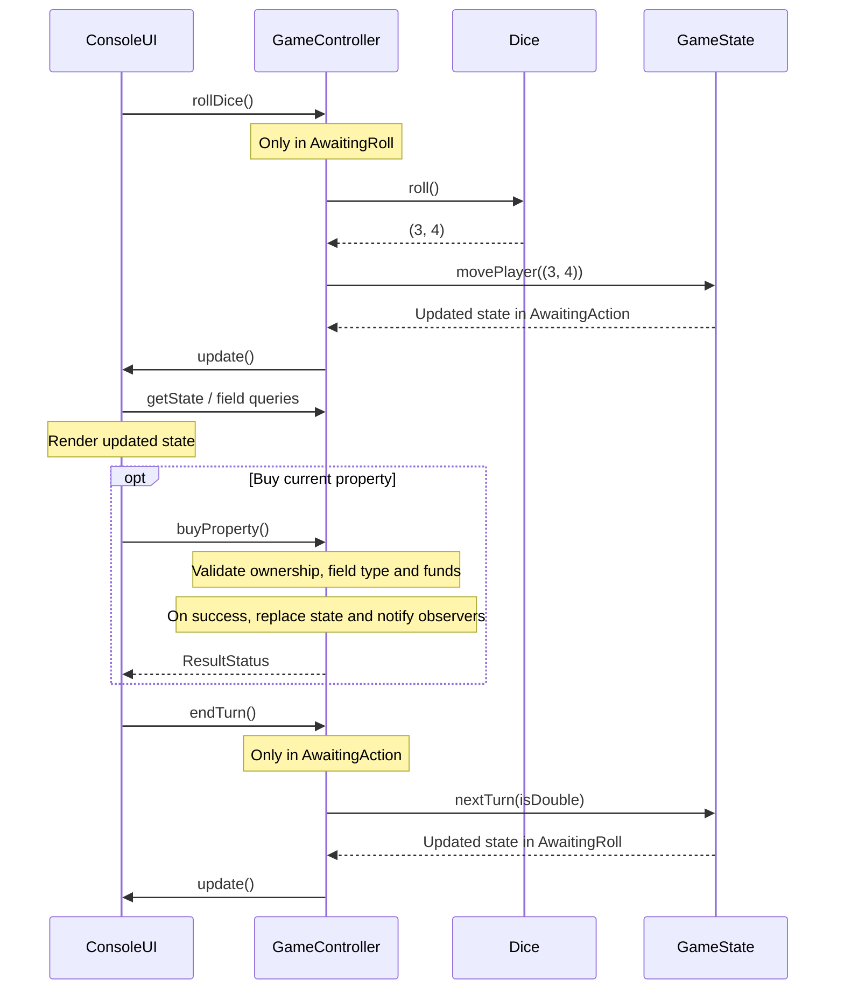

# Monopoly — Project Architecture

## Current Scope

This university project implements Monopoly in Scala 3 with sbt and ScalaTest.
The current console prototype supports rolling dice, moving around a board,
buying properties, switching turns and displaying results when the user exits.
A GUI and further game rules are planned.

`DummyBoard` and `DummyField` are temporary placeholders used while the other
team member develops the board and field classes. They allow game logic and UI
work to continue independently. Their layout, prices and rents are sample data,
not the final Monopoly board or rules.

## Components and Dependencies



Solid arrows show dependencies; dashed arrows show interface implementations.

| Component | Current responsibility and status |
|---|---|
| `Player` | Immutable player data; `pay`, `receive` and `changePosition`. Jail, vacation and bankruptcy flags are stored, but their rules are unfinished. |
| `Dice` | Interface for rolling two dice. `RandomDice` generates values; `FixedDice` supplies deterministic values for tests. |
| `GameState` | Immutable players, current player index, property ownership, board, last roll and turn phase. Includes a standalone game-over check. |
| `GameController` | Holds the current state, coordinates rolls, turn changes and purchases, and notifies observers after successful state changes. Further rules are unfinished. |
| `Observer` | Defines `update(): Unit` for change notifications. |
| `ConsoleUI` | Reads commands, observes the controller, renders the current state and displays results on exit. |
| `Board` | Interface exposing `size: Int` and `getField(position: Int): Field`. |
| `Field` | Interface exposing `cost`, `rent`, `name` and `fieldType`. |
| `DummyBoard`, `DummyField` | Temporary implementations pending integration of the other team member's classes. The default board has 11 fields: Start and 10 businesses. |
| `FieldType` | Initial enum of field categories; most category-specific actions are not implemented. |
| `ResultStatus` | Purchase outcomes: `Success`, `NotPurchasable`, `OwnerIsYou`, `AlreadyOwned` and `InsufficientFunds`. |

## Turn Execution

The turn phases are `TurnPhase.turnPhases.AwaitingRoll` and `AwaitingAction`.



Movement wraps using `board.size`. A double keeps the current player for another
roll; otherwise the index advances to the next player. A second roll before
ending the turn and an end-turn command before rolling are ignored.
`buyProperty()` currently has no turn-phase restriction.

## State and Identity

`Player` and `GameState` are case classes. Their operations return updated copies.
The controller stores the latest `GameState` in a private variable; input-loop
state, observer registration and configurable test dice also use mutable state.

Property ownership is represented by `propertyMap: Map[Int, Int]`:

- Key: board position.
- Value: player ID.

Player IDs must be unique and stable for ownership lookup. `monopoly.main`
assigns explicit IDs, but the model currently permits duplicate IDs and defaults
to `-1`.

`lastRoll: Option[(Int, (Int, Int))]` is `None` before the first roll. The first
integer currently stores the **index in `players`**, followed by the two dice
values. It is not a player ID, despite the source comment. The UI uses that
index to display the player who rolled, including after a turn change.

## Integration with the Board and Field Implementation

The other team member owns development of the concrete board and field classes.
`DummyBoard` and `DummyField` bridge that unfinished integration and should be
replaced when the real implementations are ready.

Game state and controller APIs use `Board` and `Field`, so a compatible board can
be supplied through `GameState(players = players, board = actualBoard)`.
`GameState` currently defaults to `DummyBoard()`; the application entry point
uses this default. Tests also rely on the placeholder layout and prices.

Before replacing the placeholders, agree on the `Board` and `Field` contracts,
position numbering and field categories. Update application wiring and tests
that depend on sample data. The current interfaces are integration contracts in
this branch; they do not imply that the other member's implementation is already
compatible. The target full board has 40 fields, but `Board` does not enforce a
particular size.

## Testing and Build

Tests use ScalaTest `AnyWordSpec` and `Matchers`. Model, controller and view tests
are organized into matching packages; `MonopolySpec` tests the entry point.
UI tests provide input streams and capture output. `FixedDice` makes movement
deterministic.

```sh
sbt test
sbt clean coverage test coverageReport
```

The HTML coverage report is generated at
`target/scala-3.9.0/scoverage-report/index.html`.
The GitHub Actions workflow runs tests with coverage and then a SonarQube scan
on pushes to `main` and pull requests. Coverage shows executed code; it does not
guarantee that all edge cases and game rules have been tested.

## Remaining Work and Known Limitations

- Integrate the other team member's board and field implementations.
- Implement rent, rewards for crossing Start, field events, taxes, jail,
  vacation and the three-consecutive-doubles rule.
- Connect bankruptcy and game-over handling to gameplay. `checkGameOver` counts
  non-bankrupt players, but the controller never calls it, actions do not check
  `isGameOver`, and turn changes do not skip bankrupt players.
- Display purchase failure messages; the UI currently ignores `ResultStatus`.
- Validate player identity and state inputs, and clarify the `lastRoll` contract.
- Validate initial `FixedDice` values consistently with `setValues`.
- Add tests for these edge cases and observer notifications.
- Add a main menu, full board rendering and a GUI in later stages.
