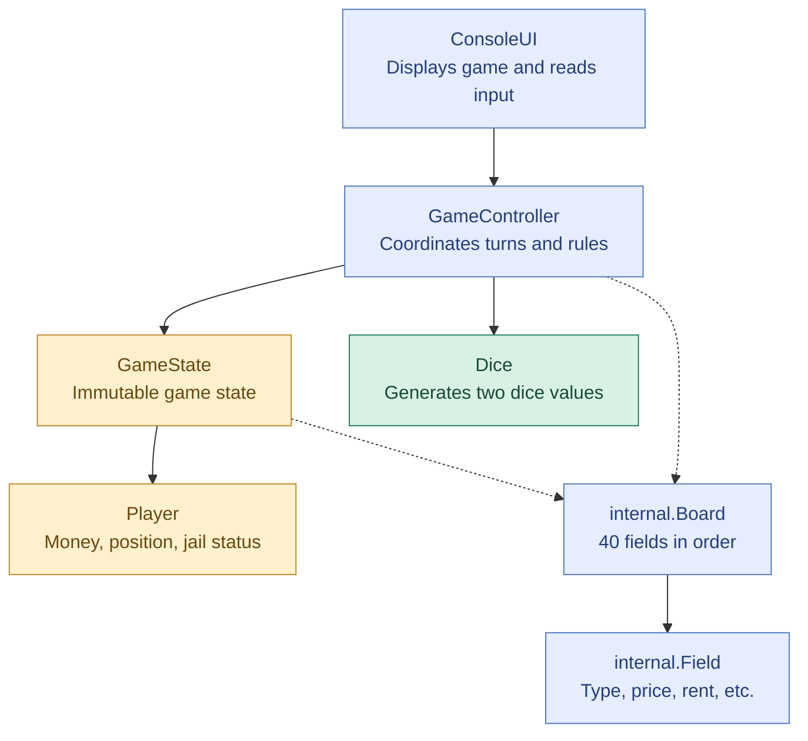
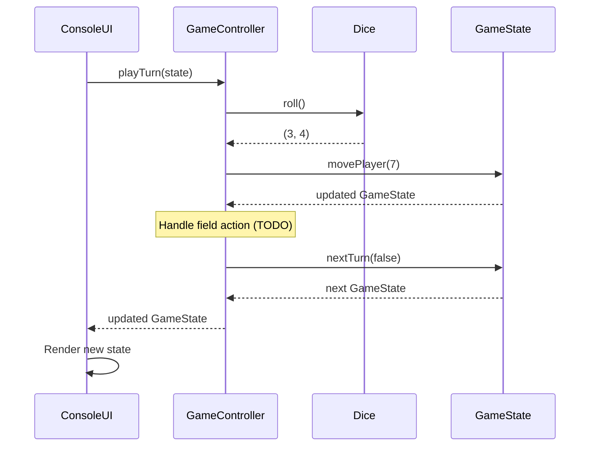

# Monopoly — Project Architecture

## 1. Architecture Overview



**Legend:**
- 🟢 Green — Implemented
- 🟡 Yellow — Partially implemented
- 🔵 Blue — Planned
- Solid arrows — Component dependencies
- Dashed arrows — Planned dependencies

## 2. Component Responsibilities

| Component | Status | Responsibility |
|---|---|---|
| `Player` | 🟡 Partial | Stores player data and provides immutable operations such as `move()` and `pay()`. |
| `RandomDice$` | 🟢 Done | Generates two random dice values. |
| `GameState` | 🟡 Partial | Stores players, current turn, game-over status and property ownership. |
| `GameController` | 🔵 Planned | Coordinates turns and handles game rules, purchases and rent. |
| `Board` | 🔵 Planned | Contains the ordered collection of 40 fields. |
| `Field` | 🔵 Planned | Represents a board location and its properties. |
| `ConsoleUI` | 🔵 Planned | Displays information and handles user input without implementing game rules. |

## 3. Turn Execution

The `GameController` coordinates a turn by calling methods from other components.



This diagram represents the simplified turn flow. Additional rules such as jail, property purchases, rent and bankruptcy will be added later.

## 4. Division of Work

### Game Logic

- [x] Dice
- [ ] Player (partially implemented)
- [ ] GameState (partially implemented)
- [ ] GameController
- [ ] Game logic unit tests (partially implemented)

### internal.Board Model

- [x] FieldType (initial enum)
- [ ] internal.Field
- [ ] internal.Board
- [ ] internal.Field properties (price, rent, etc.)
- [ ] internal.Board and field unit tests

### User Interface

- [ ] ConsoleUI
- [ ] Main menu
- [ ] Game board rendering
- [ ] Player interaction
- [ ] Graphical UI (later stage)

## 5. Design Decisions

### Immutability

We use immutable data structures wherever possible.

State changes return new objects using `copy()` rather than modifying existing objects.

### Separation of Concerns

Each component has a specific responsibility:

- `Player` manages individual player data.
- `GameState` stores the current game state.
- `GameController` coordinates actions and applies game rules.
- `Board` defines the board layout.
- `Field` describes individual board locations.
- `ConsoleUI` handles presentation and user input.

### Property Ownership

Property ownership is planned to be represented using:

```scala
propertyMap: Map[Int, Int]
```

- **Key:** internal.Board position
- **Value:** Player ID

Player IDs should remain stable throughout the game.

### Testing

Unit tests use ScalaTest with `AnyWordSpec` and `Matchers`.

Game logic should be testable independently of random dice rolls and the user interface.

## 6. Planned Features

- [ ] Complete player functionality
- [ ] internal.Board and field implementation
- [ ] GameController and turn execution
- [ ] Property purchasing
- [ ] Rent payments
- [ ] Jail mechanics
- [ ] Three consecutive doubles rule
- [ ] Bankruptcy and game-over detection
- [ ] Console user interface
- [ ] Graphical user interface

---

**Note:** This architecture is an initial design and may change as the project develops.
